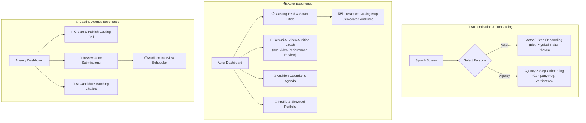

# 📱 CastMate — Android Native Mobile Client

[](https://developer.android.com)
[](https://kotlinlang.org)
[](https://developer.android.com/jetpack/compose)
[](https://ai.google.dev/)
[](https://developer.android.com/training/data-storage/room)
[](https://square.github.io/retrofit/)
[](https://developers.google.com/maps)
[](https://opensource.org/licenses/MIT)

> **CastMate Android** is the native mobile client for the CastMate casting platform. Built entirely with modern **Kotlin and Jetpack Compose**, it connects aspiring actors with film, TV, and commercial casting agencies. Features an **autonomous AI video audition coach powered by Google Gemini 1.5 Flash**, interactive **Google Maps casting radar**, audition agenda scheduling, and offline-first Room persistence.

---

## 🧭 Multi-Branch Architecture

This repository is organized into dedicated branches for clear separation of concerns:

| Branch | Component | Description |
| :--- | :--- | :--- |
| [**`main`**](https://github.com/negzaoui16/CastMate) | **Global Architecture** | System overview, end-to-end Mermaid blueprints, Hedera blockchain & AI pipeline |
| [**`frontend`**](https://github.com/negzaoui16/CastMate/tree/frontend) *(this branch)* | **Android Native Client** | Pure Kotlin & Jetpack Compose mobile application with Gemini coaching |
| [**`backend`**](https://github.com/negzaoui16/CastMate/tree/backend) | **NestJS API Gateway** | Scalable NestJS backend, MongoDB, Hedera DLT contracts & media pipeline |

---

## 🎭 Dual-Persona System Architecture

CastMate provides two distinct, tailored user experiences within a unified native codebase:



---

## 🌟 Key Features

### 1. 🤖 Gemini 1.5 Flash AI Video Audition Coach
* Actors can record or upload a **30-second audition video** directly from the mobile app.
* **Google Gemini 1.5 Flash** analyzes the video in real-time, evaluating:
  * **Facial Expressiveness & Emotion** (Authenticity, intensity, transition).
  * **Vocal Delivery & Diction** (Pacing, clarity, tone).
  * **Screen Presence & Posture**.
* Generates a **comprehensive performance scorecard** with a numerical score (`0-100`) and constructive tips for improvement before submitting to real directors.

### 2. 🗺️ Geolocation Casting Radar (Google Maps SDK)
* Interactive map displaying nearby film studios, agency headquarters, and active casting call locations.
* Direct geolocation-based distance calculation and directions to audition venues.

### 3. 💾 Offline-First Local Storage (Room Database)
* Local SQLite cache using **Android Room ORM** (`CastMateDatabase`).
* `ChatDao` manages conversation threads and messages locally for instant UI rendering and smooth offline support.

### 4. 📅 Audition Scheduler & Calendar
* Synchronized calendar tracking upcoming in-person and remote auditions.
* Push notifications and status updates (Pending, Accepted, Shortlisted, Scheduled).

---

## 🛠️ Technology Stack & Dependencies

| Layer | Technologies |
| :--- | :--- |
| **Language** | Kotlin 2.x (100% Kotlin codebase) |
| **UI Toolkit** | Jetpack Compose (Declarative UI), Material Design 3 |
| **AI Integration** | Google Gemini 1.5 Flash / Pro API (Google AI Generative Language) |
| **Architecture** | MVVM / Clean Architecture with StateFlow & Coroutines |
| **Local Persistence** | Android Room Database (SQLite ORM) |
| **Networking** | Retrofit 2, OkHttp 3, Gson Converter Factory |
| **Maps & Location** | Google Maps SDK for Android, Play Services Location |
| **Image Loading** | Coil (Coroutine Image Loader) |
| **Target SDK** | compileSdk 36, minSdk 24, targetSdk 36 |

---

## 📂 Project Structure

```
app/src/main/java/com/example/projecct_mobile/
├── ai/                      # Gemini AI video analysis & training services
│   └── GeminiTrainingService.kt
├── data/                    # Data layer: API clients, models & local database
│   ├── api/                 # Retrofit services (Auth, Acteur, Agence, Casting, Media)
│   ├── local/               # TokenManager & Room database
│   │   └── database/        # CastMateDatabase, ChatDao, ChatMessageEntity
│   └── model/               # DTOs, signup requests, and profile models
├── ui/                      # Presentation layer (Jetpack Compose)
│   ├── components/          # Reusable Compose widgets & navigation bars
│   ├── screens/
│   │   ├── acteur/          # Actor dashboard, profile, favorites, AI training
│   │   ├── agence/          # Agency auth, casting creation, candidate review
│   │   ├── agenda/          # Audition calendar & appointments
│   │   ├── auth/            # Sign in, multi-step sign up, password recovery
│   │   ├── casting/         # Casting list, detail view, application dialogs
│   │   └── map/             # Google Maps casting radar
│   ├── theme/               # Material 3 colors, typography, and themes
│   └── utils/               # Helpers, config & formatters
└── MainActivity.kt          # Single-activity navigation root
```

---

## 🚀 Getting Started

### Prerequisites
* **Android Studio**: Ladybug / Hedgehog or newer
* **JDK**: Version 17 or higher
* **Android Device / Emulator**: Running Android 7.0 (API 24) or higher

### Setup & Compilation
1. **Clone the repository and checkout the frontend branch:**
   ```bash
   git clone -b frontend https://github.com/negzaoui16/CastMate.git
   cd CastMate
   ```

2. **Configure your Gemini API Key:**
   Open or create `local.properties` in the project root:
   ```properties
   sdk.dir=C:\Users\<YourUsername>\AppData\Local\Android\Sdk
   gemini.api.key=YOUR_GEMINI_API_KEY
   ```
   *(Get your free API key at [Google AI Studio](https://aistudio.google.com/app/apikey))*.

3. **Open in Android Studio:**
   * Open Android Studio and select **Open Project** -> select the cloned folder.
   * Let Gradle sync dependencies.
   * Run the app on an emulator or physical device via **Run 'app'** (`Shift + F10`).

---

## 👤 Author

**Oussama Negzaoui**
* 🎓 Software Engineering Student at **ESPRIT** (Option Mobile, Class of 2027)
* 🎓 Bachelor's Degree in Computer Science from **ISAMM** (Class of 2024)
* 💼 GitHub: [@negzaoui16](https://github.com/negzaoui16)
* 🌐 LinkedIn: [linkedin.com/in/oussamanegzaoui](https://www.linkedin.com/in/oussamanegzaoui/)

---

## 📄 License

This project is licensed under the **MIT License** — see the [LICENSE](LICENSE) file for details.
