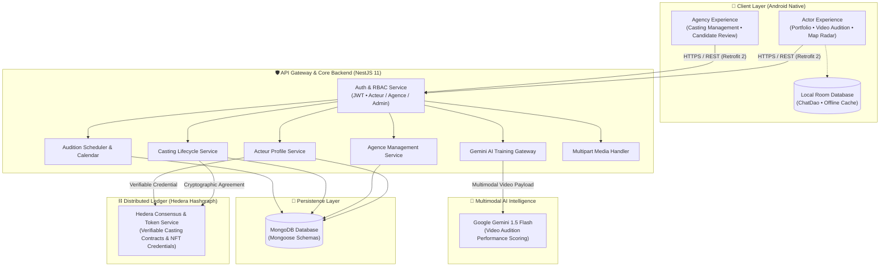

# 🎭 CastMate — AI-Powered Talent Casting & Verification Platform

[](https://developer.android.com)
[](https://kotlinlang.org)
[](https://developer.android.com/jetpack/compose)
[](https://nestjs.com)
[](https://www.typescriptlang.org)
[](https://www.mongodb.com)
[](https://hedera.com)
[](https://ai.google.dev/)
[](https://opensource.org/licenses/MIT)

> **CastMate** is a next-generation talent discovery and casting management ecosystem for the entertainment, film, and commercial media industries. It bridges the gap between independent aspiring actors and licensed casting directors by combining an **Android Native client (Kotlin & Jetpack Compose)** with a **modular NestJS API gateway**. Features an **autonomous AI video audition coach powered by Google Gemini 1.5 Flash**, **cryptographic casting agreements on Hedera Hashgraph DLT**, an **interactive Google Maps casting radar**, and offline-first Room database caching.

---

## 🗂️ Multi-Branch Repository Architecture

To maintain high code cohesion and independent deployment lifecycles, **CastMate** is organized into specialized branches:

| Branch | Component | Description & Tech Stack |
| :--- | :--- | :--- |
| **`main`** *(this branch)* | **System Architecture & Hub** | End-to-end architecture blueprints, system data flows, DLT specs, and project documentation |
| [**`frontend`**](https://github.com/negzaoui16/CastMate/tree/frontend) | **Android Native Client** | Pure Kotlin & Jetpack Compose mobile app (Material 3, Gemini video analysis, Google Maps, Room DB) |
| [**`backend`**](https://github.com/negzaoui16/CastMate/tree/backend) | **NestJS API Gateway** | Modular NestJS 11 backend (TypeScript, MongoDB Mongoose, Hedera Hashgraph DLT, JWT RBAC, Multer) |

---

## 🏛️ System Architecture

The following diagram illustrates the complete end-to-end architecture and data flow between the Android native mobile client, the NestJS API gateway, Google Gemini AI, and the Hedera Hashgraph distributed ledger:



---

## 🌟 Key Features

### 1. 🤖 Gemini 1.5 Flash AI Video Audition Coach
* Actors submit up to a **30-second audition video** directly through the mobile app.
* **Google Gemini 1.5 Flash** evaluates the performance across multiple dimensions:
  * **Facial Emotion & Expression**: Emotional depth, authenticity, and natural transitions.
  * **Diction & Vocal Delivery**: Articulation, pacing, and vocal projection.
  * **Body Language & Screen Presence**: Posture, eye contact, and confidence.
* Delivers an **instant performance score (`0–100`)** and detailed, constructive coaching points to help actors refine their craft before live auditions.

### 2. 🗺️ Geolocation Casting Radar (Google Maps SDK)
* Dynamic interactive map showing open casting calls, production studio locations, and filming sets.
* Location-based distance calculation, geolocation filtering, and turn-by-turn route directions.

### 3. ⛓️ Hedera Hashgraph Distributed Ledger Technology (DLT)
* **Verifiable Casting Agreements**: Contracts between agencies and selected actors are hashed and committed to Hedera Consensus Service (HCS), providing immutable proof of engagement.
* **Decentralized Talent Credentials**: Audition certificates and verified role achievements are anchored on-chain, giving actors a verifiable, portable professional record.

### 4. 👥 Dual-Persona Tailored Experience
* **Actor Hub**: Multi-step registration, profile showcase (headshots, physical measurements, showreel links), casting search with smart filters, saved favorites, and audition calendar.
* **Agency Hub**: Verified business accounts, casting call publisher, applicant management dashboard, and audition interview scheduler.

### 5. 💾 Offline-First Local Storage (Android Room ORM)
* Seamless caching of conversation threads, auditions, and active casting bookmarks using Android's native **Room Database** (`CastMateDatabase`).

---

## 🛠️ Technology Stack

| Layer | Technologies |
| :--- | :--- |
| **Mobile Client** | Kotlin 2.x, Jetpack Compose, Material Design 3, Coroutines, StateFlow, Room DB, Retrofit 2, OkHttp 3, Google Maps SDK, Coil |
| **Backend API** | NestJS 11.x, TypeScript 5.x, Express, Passport.js, `@nestjs/jwt`, `bcrypt` |
| **Database** | MongoDB Atlas with Mongoose ODM |
| **Blockchain / DLT** | Hedera Hashgraph JavaScript SDK (`@hashgraph/sdk`), Testnet HCS |
| **Artificial Intelligence** | Google Generative AI (Gemini 1.5 Flash & Pro APIs) |
| **Media Handling** | Multer multipart streaming |
| **DevOps & Tooling** | Android Studio Ladybug+, Node.js 20+, Git, ESLint, Prettier |

---

## 🚀 Getting Started

### Prerequisites
* **Android Studio**: Ladybug / Hedgehog or newer with JDK 17+
* **Node.js**: `v20.x` or higher
* **MongoDB**: Local instance or MongoDB Atlas cluster connection

### 1. Backend Setup
```bash
# Clone the repository
git clone https://github.com/negzaoui16/CastMate.git
cd CastMate

# Checkout the backend branch
git checkout backend

# Install dependencies
npm install

# Configure environment variables
cp .env.example .env
# Edit .env with your MongoDB URI, Hedera credentials, and JWT secret

# Start development server
npm run start:dev
```
The backend API will be live at `http://localhost:3000`.

### 2. Mobile Client Setup
```bash
# Checkout the frontend branch
git checkout frontend

# Open in Android Studio
# Set your Gemini API key in local.properties:
# gemini.api.key=YOUR_GEMINI_API_KEY

# Build and run on an Android device or emulator
```

---

## 👤 Author

**Oussama Negzaoui**
* 🎓 Software Engineering Student at **ESPRIT** (Option Mobile, Class of 2027)
* 🎓 Bachelor's Degree in Computer Science from **ISAMM** (Class of 2024)
* 💼 GitHub: [@negzaoui16](https://github.com/negzaoui16)
* 🌐 LinkedIn: [linkedin.com/in/oussamanegzaoui](https://www.linkedin.com/in/oussamanegzaoui/)

---

## 📄 License

This project is licensed under the **MIT License** — see the [LICENSE](LICENSE) file for details.
