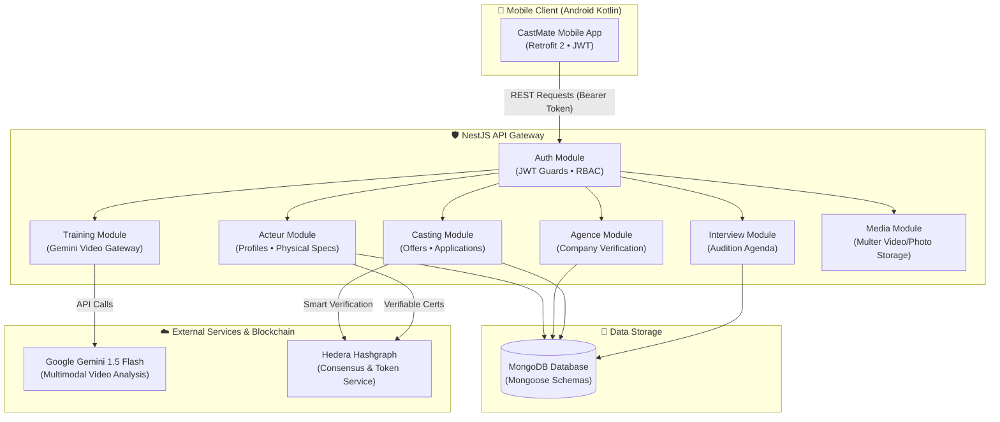

# ⚙️ CastMate — Backend API & DLT Gateway

[](https://nestjs.com)
[](https://www.typescriptlang.org)
[](https://www.mongodb.com)
[](https://hedera.com)
[](https://ai.google.dev/)
[](https://jwt.io)
[](https://opensource.org/licenses/MIT)

> **CastMate Backend** is the scalable core API gateway for the CastMate casting platform. Built with **NestJS 11** and **TypeScript**, it handles multi-role authentication (`ACTEUR`, `AGENCE`, `ADMIN`), casting lifecycle management, audition scheduling, **Google Gemini 1.5 Flash AI audition evaluation**, and **Hedera Hashgraph Distributed Ledger (DLT)** for verifiable digital casting agreements and certifications.

---

## 🧭 Multi-Branch Architecture

This repository is organized into dedicated branches for clear separation of concerns:

| Branch | Component | Description |
| :--- | :--- | :--- |
| [**`main`**](https://github.com/negzaoui16/CastMate) | **Global Architecture** | System overview, end-to-end Mermaid blueprints, Hedera blockchain & AI pipeline |
| [**`frontend`**](https://github.com/negzaoui16/CastMate/tree/frontend) | **Android Native Client** | Pure Kotlin & Jetpack Compose mobile application with Gemini coaching |
| [**`backend`**](https://github.com/negzaoui16/CastMate/tree/backend) *(this branch)* | **NestJS API Gateway** | Scalable NestJS backend, MongoDB, Hedera DLT contracts & media pipeline |

---

## 🏛️ Modular System Architecture

CastMate Backend follows NestJS modular architecture principles, dividing domains into cohesive, decoupled services:



---

## 📦 Core Modules Breakdown

| Module | Responsibilities | Key Endpoints / Services |
| :--- | :--- | :--- |
| **`auth`** | Multi-role registration & login, password hashing with bcrypt, JWT token generation & verification | `/auth/login`, `/auth/register-actor`, `/auth/register-agency`, `JwtAuthGuard`, `RolesGuard` |
| **`acteur`** | Actor profile CRUD, physical specs (height, eye color, hair), portfolio photos, showreel links | `/acteur/profile`, `/acteur/update`, `/acteur/search` |
| **`agence`** | Casting agency onboarding, business verification, agency dashboard stats | `/agence/profile`, `/agence/verify` |
| **`castings`** | Publishing casting calls, role requirements, actor applications, status workflows | `/castings/create`, `/castings/apply`, `/castings/filter` |
| **`interviews`** | Scheduling audition slots, calendar synchronisation, confirmation notifications | `/interviews/schedule`, `/interviews/my-auditions` |
| **`training`** | Gateway for Google Gemini AI audition performance analysis & feedback generation | `/training/evaluate-video`, `GeminiService` |
| **`media`** | Multipart upload handling for audition videos, actor headshots, and casting assets | `/media/upload-video`, `/media/upload-photo` |
| **`common`** | Shared utilities, Hedera Hashgraph DLT SDK client, global exception filters | `HederaService`, `HttpExceptionFilter` |

---

## ⛓️ Hedera Hashgraph DLT Integration

CastMate leverages **Hedera Hashgraph (Testnet)** to establish trust between independent actors and casting agencies:
* **Verifiable Casting Agreements**: Once an actor is selected, a cryptographic record of the agreement is committed to the Hedera network, creating a tamper-proof timestamp and contract hash.
* **Actor Experience Credentials**: Verified audition completions and role credits can be minted as cryptographic credentials, allowing actors to build a portable, decentralized talent portfolio.

---

## 🛠️ Technology Stack

* **Framework**: NestJS 11.x
* **Language**: TypeScript 5.x
* **Database**: MongoDB with Mongoose ODM
* **DLT / Blockchain**: Hedera Hashgraph JavaScript SDK (`@hashgraph/sdk`)
* **AI Provider**: Google Generative AI (Gemini 1.5 Flash API)
* **Authentication**: Passport.js, `@nestjs/jwt`, `bcrypt`
* **File Uploads**: Multer, stream handling
* **Code Quality**: ESLint, Prettier, Jest

---

## 🚀 Getting Started

### Prerequisites
* **Node.js**: `v20.x` or higher
* **npm**: `v10.x` or higher
* **MongoDB**: Local MongoDB instance or MongoDB Atlas cluster

### Installation & Run
1. **Clone the repository and checkout the backend branch:**
   ```bash
   git clone -b backend https://github.com/negzaoui16/CastMate.git
   cd CastMate
   ```

2. **Install dependencies:**
   ```bash
   npm install
   ```

3. **Configure Environment Variables:**
   ```bash
   cp .env.example .env
   ```
   Open `.env` and fill in your MongoDB URI, JWT Secret, and Hedera credentials:
   ```env
   PORT=3000
   JWT_SECRET=your_jwt_secret_key
   MONGODB_URI=mongodb+srv://<user>:<password>@cluster.mongodb.net/castmate
   HEDERA_NETWORK=testnet
   HEDERA_ACCOUNT_ID=0.0.1234567
   HEDERA_PRIVATE_KEY=0x0000000000000000000000000000000000000000000000000000000000000000
   ```

4. **Start the development server:**
   ```bash
   npm run start:dev
   ```
   The backend API will start on `http://localhost:3000`.

---

## 👤 Author

**Oussama Negzaoui**
* 🎓 Software Engineering Student at **ESPRIT** (Option Mobile, Class of 2027)
* 🎓 Bachelor's Degree in Computer Science from **ISAMM** (Class of 2024)
* 💼 GitHub: [@negzaoui16](https://github.com/negzaoui16)
* 🌐 LinkedIn: [linkedin.com/in/oussamanegzaoui](https://www.linkedin.com/in/oussamanegzaoui/)

---

## 📄 License

This project is licensed under the **MIT License** — see the [LICENSE](LICENSE) file for details.
